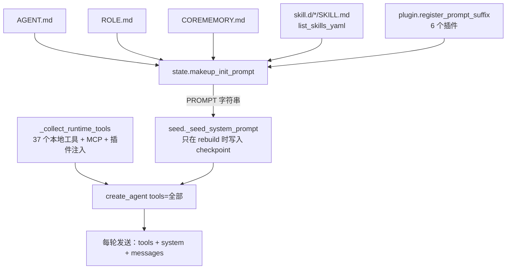
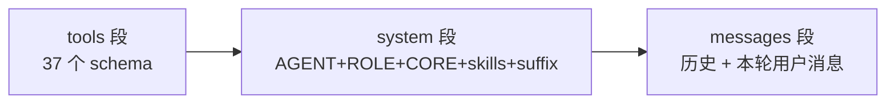

# 初始提示词预算优化设计（零缓存影响版）

> 状态：**设计草案，未实现**
> 基线日期：2026-11-03（数字来自 `logs/faust.log` 与 `~/.faustbot/agents/faust` 实测）
> **硬约束：不得降低前缀缓存命中率。** 所有方案都按此约束筛选，违反者一律不采纳（见 §5.2）。

---

## 0. TL;DR

| | 现状 | 目标 |
|---|---|---|
| System 消息 | 可核对 28.8k 字符，日志实测 **35.6k–44.7k 字符** | ≤ 6k 字符 |
| 工具 schema | **37 个**，描述 24.2k 字符 | 37 个，描述 ≤ 4.6k 字符（**工具集不变**） |
| 首轮请求 | **≈ 20k–24k tokens** | **≈ 6.5k tokens（−70%）** |
| 缓存命中率 | 基线 | **不劣于基线**（前缀字节稳定，见 §5） |

两条主线，都不触碰请求前缀的稳定性：

- **Part A 渐进式披露**：低频正文从 system 挪到 `faustbot://` / `skill://` 节点（system 只在 rebuild 时变化，短了反而更利于缓存）。
- **Part B 工具预算**：**不**做逐轮工具激活；把 37 个工具的描述从"手册"压成"签名"，正文进 VFS。工具名与顺序完全不变 → 前缀逐字节稳定。

> 明确放弃：per-turn 动态工具集（Anthropic `defer_loading` 式的自研版）。它省 token 但每次激活都会全量 miss，与本次约束直接冲突，理由见 §9.C。

---

## 1. 现状

### 1.1 组装链路



关键位置：

| 环节 | 代码 |
|---|---|
| 拼接 system 文本 | [`makeup_init_prompt`](../backend/faust_backend/agent/runtime/state.py#L122) |
| 写入 checkpoint | [`_seed_system_prompt`](../backend/faust_backend/agent/prompt/seed.py#L29) |
| 收集工具 | [`_collect_runtime_tools`](../backend/faust_backend/agent/runtime/build.py#L22) |
| 装配 Agent | [`_create_agent_with_extensions`](../backend/faust_backend/agent/runtime/build.py#L193) |
| 中间件栈 | [`_compose_runtime_middlewares`](../backend/faust_backend/agent/runtime/build.py#L36) |
| 工具注册表 | [`_registry.py`](../backend/faust_backend/tools/_registry.py) |

**现状已经天然满足缓存约束**：system 只在 `rebuild_runtime` 时重新植入（`seed.py` 里还有"已是目标状态就跳过"的短路），工具集只在构建期确定。这份设计的第一原则就是**不要破坏这个性质**。

### 1.2 体积实测

System 文本（live 目录 `~/.faustbot/agents/faust`）：

| 区块 | 字符 | ≈tokens | 备注 |
|---|---:|---:|---|
| `COREMEMORY.md` | 11,498 | 3.0k | **95% 是 emotion-engine 的 JSON 状态**，含 36 条历史向量 |
| `AGENT.md` | 9,964 | 4.1k | 模板与 live 一致（锁定覆盖） |
| Skills YAML（16 条） | 3,001 | 1.1k | slug + summary + usage |
| 插件 prompt suffix ×6 | ~3,200 | ~1.2k | avatar/desktop-mood/emotion/song/rss/acp |
| 固定引导文案 | ~740 | ~0.3k | [state.py#L143-L154](../backend/faust_backend/agent/runtime/state.py#L143-L154) |
| `ROLE.md` | 433 | 0.2k | |
| **小计（可核对）** | **~28.8k** | **~10k** | |
| **日志实测** | **35,650 / 44,718** | — | 差额来自运行时波动（COREMEMORY 随情绪历史膨胀、插件 suffix 动态长度） |

工具 schema（37 个，`@tool` docstring 实测 24,151 字符）：

| 域 | 工具 | 描述字符 |
|---|---:|---:|
| core | read 7,935 / write 1,629 / edit 1,471 / search 1,511 / find 1,435 / execute 1,000 / listSkills 201 | 15,182 |
| nimble | showNimbleWindowTool 2,484 / close 327 | 2,811 |
| trigger | add 1,002 / remove 104 / list 86 | 1,192 |
| animation/VRM | 5 个 | 980 |
| subagent | 5 个 | 883 |
| memory | 5 个 | 860 |
| attachment | 1 个 | 638 |
| minecraft | 4 个 | 438 |
| hil / markdown / media / diary | 5 个 | 680 |

> 37 个工具 + JSON 骨架 ≈ **9–9.5k tokens**。单个 `read` 的描述等于整个 Skills YAML 的 2.6 倍。

### 1.3 四个结构性问题

1. **机器状态住进了人设文件**：`COREMEMORY.md` 里 95% 是 JSON，模型不会去算 `boredom: 6.076`；首行还有一行 `Undefined`（角色卡无 `first_mes` 时的渲染残留）。更矛盾的是 [`admin.py#L325-L330`](../backend/faust_backend/services/admin.py#L325-L330) 把 `COREMEMORY.md` 当锁定模板每次覆盖，而 emotion-engine 把它当运行时状态写——两套所有权冲突。
2. **同一条知识存在三份**：`AGENT.md` 的 Subagent 节（1,329 字符）与 [`TASK.md`](../backend/agents_template/faust/TASK.md) 的「Subagent 工作流」重复；ACP 节（897）与 TASK.md 重复；「模型动作触发」（752）与 avatar-performance 插件 suffix 重复。三份且已开始漂移（TASK.md 的 `newSubagent` 示例缺 `model` 参数）。
3. **VFS 手册抄在工具描述里**：`read` 的 7,935 字符是一份完整 URI 手册，而 `faustbot://tool_use.md`（TASK.md 切片，见 [`_faust_vfs_runtime.py#L504`](../backend/faust_backend/tools/_faust_vfs_runtime.py#L504)）本来就是这个用途——基础设施早就有了，只是内容没搬。
4. **工具描述没有"分层"概念**：37 个同等级的长描述，其中 Minecraft/Nimble/VRM 合计 4.9k 字符，绝大多数会话一次都用不到，却每轮全量发送。

---

## 2. 约束与目标

### 2.1 不变量（实现时不可违反）

1. **前缀稳定（本次新增，最高优先级）**：两次 `rebuild_runtime` 之间，`system message` 与 `request.tools` 必须**逐字节不变**。任何"每轮重建 system / 每轮增删工具 / 每轮改名"的做法一律否决。
2. **行为契约常驻**：Core Rules、TTS/Markdown 约束、Bootstrap、能力地图留在 system。这类内容外置省不到 300 tokens，但掉的是质量。
3. **不改工具注册表**：`toollist` 是主 Agent 与 SubagentManager 共享的对象（[build.py#L152-L155](../backend/faust_backend/agent/runtime/build.py#L152-L155)），任何过滤都不能 `pop`/`del` 注册表。
4. **Provider 无关**：不依赖某个 provider 的私有字段（如 Anthropic 的 `defer_loading`）。
5. **不破坏 compact**：压缩复用同一套 system + 工具定义来命中前缀缓存（[build.py#L199-L203](../backend/faust_backend/agent/runtime/build.py#L199-L203)），工具定义必须保持不变。

### 2.2 量化目标

| 指标 | 定义 | 目标 |
|---|---|---|
| `system_chars` | `len(PROMPT)`（已有日志字段） | ≤ 6,000 |
| `tool_schema_chars` | 请求里 tools 序列化长度 | ≤ 4,600 |
| `resident_tools` | 常驻 schema 数量 | **37（不变）** |
| `est_input_tokens` | 首轮（system + tools） | ≤ 7k |
| `cache_prefix_hash` | `hash(system + tools 序列化)` | **同一会话内恒定** |
| `cache_read / input_tokens` | provider usage | ≥ 基线 |

---

## 3. 分层模型

| 层 | 放什么 | 载体 | 成本 | 判据 |
|---|---|---|---|---|
| **L0 契约** | 身份、输出约束、行为禁忌、Bootstrap、能力地图 | system | 常驻 | 每轮都可能用到 |
| **L1 目录** | 域名 + 一句话 + 触发条件；工具签名 | system（极短） | 常驻 | 用来"发现"L2 |
| **L2 正文** | 操作手册、协议细节、领域知识 | `faustbot://*` / `skill://*` / TASK.md | 按需，一次 read 往返 | 每 5 轮以上才用一次 |

延迟的代价是明确的：一次 `read` ≈ 一次工具往返（+200–600 tokens 输出 + 一轮延迟）。**低频才值得延迟**；把 Core Rules 延迟是灾难，把 Minecraft 手册延迟是收益。

**关键性质**：L2 的内容进的是 **messages 尾部**，不影响已缓存前缀——所以"渐进式披露"本身是缓存友好的，这也正是本次只做 A + B1 的原因。

---

## 4. Part A：渐进式披露（缓存安全）

### 4.1 文档分层映射

| 现有位置 | 内容 | 去向 |
|---|---|---|
| AGENT.md「Agile System」（1,824） | 何时写 Agile 模块、决策边界 | 删正文，L0 留 2 行；正文并入 `skill://agile-engine` 的"何时用"节 |
| AGENT.md「Subagent」（1,329） | 工具清单 + 工作流 | 合并到 TASK.md 同名节，L0 留 1 行 |
| AGENT.md「Memory 系统」（1,281） | 写入原则、路径规范 | L0 留 5 行（写什么、路径、不要播报），细则进 `faustbot://tool_use.md` |
| AGENT.md「外部编码 Agent」（897） | ACP 流程 | 与 TASK.md 重复，只留 TASK.md 一份，L0 留 1 行 |
| AGENT.md「模型动作触发」（752） | 工具 vs token | 与 avatar-performance suffix 重复 → 只留插件 suffix（含运行时能力快照），L0 留 1 行 |
| AGENT.md「Trigger」（1,132） | 何时建、间隔表 | L0 留间隔表 + 1 条禁忌 |
| AGENT.md「服务端搜索」「会话压缩」（1,063） | 行为说明 | L0 各留 2 行（不写就会说错话的契约） |
| `read` docstring（7,935） | 全 scheme 手册 | 描述压到 ~900 字符；正文进 `faustbot://tool_use.md` 新节 |
| COREMEMORY.md（11,498） | 情绪状态 JSON | 摘要 ~400 字符；原文进 `faustbot://emotion/state.json` |
| Skills YAML（3,001） | 16 × (summary+usage) | 只留 `slug: 触发条件`（≤1,200 字符）；详情走 `listSkills(show_detail=True)` |

### 4.2 AGENT.md 目标骨架

```markdown
# Filename:AGENT.md

## Core Rules:            ← 原样保留（477 字符，不要动）
...

## 能力地图（不确定就查，别猜）
| 你想做的事 | 入口 |
|---|---|
| 现在立刻改表情/动作 | listAvatarCapabilities() |
| 玩 Minecraft | read("skill://minecraft/SKILL.md") |
| 长期感知/定时抓取 | read("skill://agile-engine/SKILL.md") |
| 桌面此刻在发生什么 | read("faustbot://desktop-mood/overview.md") |
| 后台跑长任务 | newSubagent(...) → read("faustbot://subagenting.md") |
| 外包编码给外部 Agent | read("skill://agent-communicate/SKILL.md") |
| 工具用法/参数/失败语义 | read("faustbot://tool_use.md") |

## 虚拟协议（faustbot:// / skill:// / sourceCode://）   ← 保留原文 455 字符
## Trigger 要点（间隔表 + 不得 <90s + 前端未连接不是故障） ← 压到 ~350 字符
## 记忆写入（写什么/路径/不要播报）                        ← 压到 ~450 字符
## Bootstrap 流程                                        ← 原样保留 309 字符
```

目标 **≤ 3,800 字符**（当前 9,964）。

> `faust` 的 AGENT/ROLE/COREMEMORY/TASK 是**锁定模板**（[`admin.py#L325-L330`](../backend/faust_backend/services/admin.py#L325-L330) 每次从 `agents_template/faust/` 覆盖）；其它 agent（EmilSinclair/Lumi/ishmael）只在首次创建时拷贝，需要一次性迁移或手动同步。

### 4.3 `read` 工具描述瘦身（模板）

```python
"""读取文件/目录/记忆/工具输出/系统资源的统一入口。

uri 支持六种 scheme：普通路径、memory://、faustbot://、skill://、
sourceCode://、artifact://；目录一律自动 listdir。

选择器（追加在 uri 后）：
- `:50-100` / `:42`  按绝对行号读，最省 token 的读法
- `:raw`             关闭源码结构化摘要，返回原文

常用参数：
- show_line_number=True  输出前置绝对行号（配合 edit 用）
- with_metadata=False    目录列表不带 size/行数/日期
- force_plain_text=True  图片只返回元数据，不附加图像块（非视觉模型必须用）

完整手册（每个 scheme 的示例与边界）：
    read("faustbot://tool_use.md")   # 节：读取器完整手册
"""
```

7,935 → ~900 字符（−2.5k tokens/轮）。原文一字不丢地搬进 TASK.md 新节，由 `faustbot://tool_use.md` 暴露——**零信息损失，只换位置**，且位置在 messages 尾部（缓存安全）。

> 实现注意：现有 `faustbot://tool_use.md` 只是 `_read_task_section("## 核心工具速查")` 的单节切片（[`_faust_vfs_runtime.py#L504`](../backend/faust_backend/tools/_faust_vfs_runtime.py#L504)），一个节点对应 TASK.md 的一个 `##` 节。新增的「读取器完整手册」「工具参数表」「触发器 schema」需要各自 `write_symbolic` 一个节点（如 `faustbot://tools/read.md`），或把 `tool_use.md` 改成列出各节的索引页。**建议后者**：节点数不膨胀，模型一次 listdir 就看到全部入口。


### 4.4 COREMEMORY 摘要化

现状（11,498 字符）：

```json
{"plugin":"emotion-engine","vector":{"joy":0.0,...,"boredom":6.076},
 "dominant_emotion":"boredom","recent_user_modes":["task","task","chat",...],
 "history":[ 36 × {"ts":...,"reason":"heartbeat","deltas":{...},"vector":{...}} ]}
```

目标（≤400 字符，由 emotion-engine 的 `sync_corememory` 直接生成自然语言）：

```markdown
## 当前情绪
- 主导：boredom（6.1/10，连续 3 次心跳上升）
- 次高：curiosity（2.6）
- 用户最近 6 轮：4 次闲聊、2 次任务
- 最近 24h：被心跳唤醒 36 次，无事件触发
（原始向量与历史：faustbot://emotion/state.json）
```

设计要点：

- **更新时机受 §2.1 约束**：摘要只在 **rebuild 时**参与 system 组装。若想要"更实时"，只能走**消息尾部注入**（形如现有的 `[Memory]` 块），**绝不能每轮改 system**——那是本设计里最容易被顺手写错、且代价最大的一处。
- **写入方唯一**：仍是 emotion-engine，但渲染摘要 + 写 VFS 节点；`COREMEMORY.md` 只承载摘要块。
- **所有权修正**：既然 `COREMEMORY.md` 会被 `_ensure_agent_core_files` 覆盖，情绪状态就不该写回它。状态独立成 `emotion.state.json`，由 prompt 组装器在 rebuild 时读取并渲染。
- **顺手修脏数据**：`Undefined` 来自 [`render_corememory_md`](../backend/faust_backend/agent/prompt/character_card.py#L313) 在 `first_mes` 为空时的渲染，卡片无开场白时应整段省略该节。
- 收益：**−11k 字符 ≈ −3.0k tokens**，且情绪描述从"模型看不懂的数字"变成"模型能用的语义"。

### 4.5 Skills 目录化

现状每条：`slug / summary(≤135) / usage(≤253)`，16 条 3,001 字符。

目标：

```yaml
mcp_skills:
  - {slug: minecraft, when: "玩 MC / 建造 / 生存 / 服务器"}
  - {slug: agile-engine, when: "想加长期感知 / 定时抓取 / 事件监听"}
  - {slug: desktop-mood-rules, when: "根据桌面情景自动说话/动作"}
```

- `when` 由 `_meta.json.usage` **截断到首个分句**（≤24 字）生成，不新写文案 → 无额外维护负担。
- 完整 summary/usage 由 `listSkills(show_detail=True)` / `get_skill_detail` 提供（已有能力）。
- 收益：3,001 → ~1,200 字符（−0.5k tokens）。

### 4.6 引导语写作规范

每条延迟项在 L0 只写三个要素，缺一不可：

```
- <能力名>：<一句话它解决什么> → read("<节点路径>")
```

反面（现有 AGENT.md 里就有）：只写"细节见 skill://xxx"，没说**什么时候**该去读。
正面：`外部编码 Agent（只用于独立长时间编码任务，不共享会话上下文）→ skill://agent-communicate`。

再补一条兜底（防止模型对着不存在的工具瞎编）：

> 不确定某能力是否存在、或不确定参数时：先 `read("faustbot://tool_use.md")`，**不要凭记忆猜工具名**。

---

## 5. Part B：工具预算（零缓存影响）

### 5.1 请求结构与缓存语义



缓存是**最长公共前缀**语义：tools 在最前，**tools 一变，system 和 messages 全部失效**。system 次之，一改则 messages 全失效。

由此得到两个唯一安全的改动位置：

| 位置 | 是否安全 | 说明 |
|---|---|---|
| tools / system | ✅ 仅 rebuild 时 | rebuild 本来就是冷启动，miss 属预期 |
| messages 尾部 | ✅ 任意时刻 | 追加不影响已缓存前缀（`read` 展开、记忆注入都在这） |
| tools / system 每轮变化 | ❌ | 每轮全量 miss，比不做优化更贵 |

> 按 Anthropic 文档，缓存前缀顺序即 tools → system → messages；DeepSeek/OpenAI 兼容层的自动前缀缓存同属最长公共前缀语义。**上线前用 `cache_read` 实测确认一次**（见 §6.1），不要只凭文档推断。

### 5.2 三条红线

1. **不逐轮增删工具**：任何"激活域"式设计都会让 tools 段变化 → 否决。
2. **不逐轮重建 system**：包括"把当前时间/情绪/桌面状态写进 system"这种看起来很自然的做法 → 否决（要走就走消息尾部）。
3. **不改变 tools 的序列化顺序或内容**：包括依赖 `set` 迭代顺序、把动态值写进 `description`、按会话改变工具名。工具列表必须来自确定的常量顺序。

### 5.3 B1：静态瘦身（默认推荐，收益最大、风险最低）

**做法**：37 个工具一个都不动，只把描述从"手册"改成"签名"。

统一格式（每行一个语义单元）：

```python
"""<一句话：它做什么、什么时候必须用它>

<1-3 条关键约束或反直觉行为>
<参数里最容易错的那个，用一行说明>

详情与示例：read("faustbot://tool_use.md")  # 节：<工具名>
"""
```

示例（`showNimbleWindowTool`，2,484 → ~220 字符）：

```python
"""弹出/更新一个自定义 HTML 交互窗口，并把用户操作回传给你。

窗口用 `faustbot://nimble/<id>/events` 读事件；`recall_text` 用于重启后恢复内容。
同一 persistent_id 再次调用会复用窗口而不是新建。

详情与协议：read("faustbot://tool_use.md")  # 节：Nimble 窗口
"""
```

落地范围：

| 工具 | 现状 | 目标 | 去向 |
|---|---:|---:|---|
| read | 7,935 | ~900 | `tool_use.md`「读取器完整手册」 |
| nimble ×2 | 2,811 | ~350 | `tool_use.md`「Nimble 窗口」 |
| write / edit / search / find | 6,046 | ~1,800 | 参数表进 `tool_use.md` |
| triggerAddTool | 1,002 | ~250 | `tool_use.md`「触发器 JSON schema」 |
| 其余 28 个 | ~6,357 | ~1,300 | 各留一行 + 指针 |
| **合计** | **24,151** | **≈4,600** | |

预期：**schema 9–9.5k → ~3.1k tokens**（含 JSON 骨架），**工具集、顺序、名字完全不变 → 缓存零影响**。

风险控制：`test_skill_extraction.py` 里有"工具速查在 TASK.md"的断言，新增的 `tool_use.md` 节要同步纳入该测试，防止"搬丢了"。

### 5.4 B2：网关（可选，进一步压缩到 ~1.5k）

若 B1 之后还想再压，引入**固定**的分发器：

```python
@tool
async def callTool(name: str, arguments: dict) -> str:
    """调用某个低频工具（名称与参数见 read("faustbot://tool_use.md")）。"""
```

- 常驻 9 个：`read / write / edit / search / find / execute / listSkills / readToolSpec / callTool`。
- 其余 28 个工具**仍注册在 ToolNode 里**（`factory.py:1084` 的 `available_tools` 包含 middleware+regular，全部工具都进 ToolNode），只是不给模型看 schema。
- `readToolSpec(name)` 返回该工具的完整参数表（进 messages 尾部，缓存安全）。
- `callTool` 内部 `await tool.ainvoke(arguments)`，参数先按 `args_schema` 校验，失败时把 schema 回给模型（错误即文档）。

**代价**：多一层间接 → 复杂参数工具的调用准确率下降，且每次调用多一轮。所以只对"低频 + 参数简单"的域开放（minecraft / media / misc / nimble），高频域（subagent / trigger / memory / avatar）保持原生常驻。

| 档 | 工具 | 常驻描述 |
|---|---|---:|
| 原生常驻 | core 6 + listSkills + subagent 5 + trigger 3 + memory 5 + avatar 5 = **25** | ~2.9k 字符 |
| 网关 | minecraft 4 + nimble 2 + media 2 + misc 4 + MCP = **12** | ~0.5k 字符 |
| 元工具 | `readToolSpec` + `callTool` | ~0.3k 字符 |

即使采用 B2，**tools 段仍然每轮一字节不变**（schema 数量固定），缓存依旧安全。**建议先只做 B1，用 2 周数据判断是否值得上 B2。**

### 5.5 B3：会话级打包（可选，最激进）

在 `rebuild` 时按"会话模式"选择工具集（如 `coding` / `minecraft` / `chat`），模式来自配置或用户显式命令：

- 只改 **rebuild 时**的 tools 段 → 缓存安全（rebuild 本来就是冷启动）。
- 但同一会话内换模式要 rebuild，体验上等价于"重开会话"。
- 适合"用户明确进入某个玩法"的场景，不适合自动切换。

### 5.6 与 compact / server tools 的关系

- **compact**：`build_mock_tools` 依赖"与主请求逐字节相同的工具 schema"。B1 只改描述文本（仍是同一个常量字符串）→ **无需改动**。这是相比动态工具集方案的最大收益：不用碰 [`compact.py`](../backend/faust_backend/agent/runtime/compact.py)。
- **server tools**：[`ServerToolMiddleware`](../backend/faust_backend/agent/runtime/middleware/server_tools.py) 只往 `request.tools` **追加** provider 托管 spec，其内容由模型配置决定 → 同一 rebuild 周期内稳定，不影响缓存。
- **MultimodalBridge / ToolCallRepair**：只改 messages → 尾部，安全。

### 5.7 MCP

MCP 工具在构建期并入 `base_tools`（[build.py#L22-L33](../backend/faust_backend/agent/runtime/build.py#L22-L33)），数量随 server 数线性增长，是唯一可能"打破 4.6k 预算"的来源。

策略（按优先级）：

1. **描述瘦身**：MCP 工具描述来自 server，无法改文本 → 在 `get_langchain_tools()` 之后包一层"截断到首行 + 指向 `readToolSpec`"的 schema 改写（仍然是常量，缓存安全）。
2. **工具数量收敛**：只挂载 `list_server_statuses` 中 running 的 server（已是现状），并在 UI 上提示"MCP 工具会占用每轮预算"。
3. **B2 网关**：MCP 工具全部走 `callTool`，常驻成本降到 0，只在需要时按名调用。

### 5.8 度量红线与回归测试

| 类型 | 用例 | 文件 |
|---|---|---|
| **缓存回归** | 同一会话连续 3 轮，`hash(system + 序列化 tools)` 必须完全相等 | 新增 `tests/test_cache_prefix_stability.py` |
| **缓存回归** | `rebuild_runtime` 之后 hash 允许变化（且只变一次） | 同上 |
| 单测 | 工具描述长度上限（每个 ≤ 400 字符，`read` ≤ 1,000） | 新增 `tests/test_tool_description_budget.py` |
| 单测 | `callTool` 参数校验失败时返回 schema | B2 落地时新增 |
| 回归 | AGENT.md / TASK.md 文本断言 | `tests/test_skill_extraction.py`、`tests/test_character_card.py` |
| 回归 | 角色卡无 `first_mes` 时不渲染 `Undefined` | `tests/test_character_card.py` |
| 回归 | compact 在 B1 之后仍命中缓存（mock tools 差异为 0） | `tests/test_harness.py` 附近 |

---

## 6. 度量与验收

### 6.1 指标与日志

`makeup_init_prompt` 末尾补一行（现有日志只有 system 字符数）：

```python
log.info("Prompt 预算: system=%d 字符 / 工具=%d 个 / schema=%d 字符",
         len(PROMPT), len(tools),
         sum(len(json.dumps(t.args_schema.model_json_schema())) for t in tools))
```

运行期（复用 `/session` 与 [`turn/usage.py`](../backend/faust_backend/agent/runtime/turn/usage.py) 的 usage 解析）：

| 指标 | 来源 | 验收 |
|---|---|---|
| `system_chars` | 启动日志 | ≤ 6,000 |
| `tool_schema_chars` | 启动日志 | ≤ 4,600 |
| `est_input_tokens`（首轮） | provider usage | ≤ 7k |
| `cache_prefix_hash` | 每轮请求前计算并打点 | 同一 rebuild 周期内恒定 |
| `cache_read / input_tokens` | usage（已有） | **≥ 基线 ±2%**（硬门槛，不达标即回滚） |
| 工具调用准确率 | 工具调用失败/重试日志 | 不退化 |

### 6.2 验收方式

1. 优化前跑一次 20 轮的标准脚本（含一次 compact、一次 read 大文件），记录 `input_tokens` 与 `cache_read` 曲线。
2. 优化后用同一脚本重跑，逐轮对比：**输入 token 应下降约 70%，`cache_read` 占比应持平或上升**。
3. `cache_read` 占比下降 → 说明前缀被污染，按 §5.2 红线逐条排查（最常见元凶：某处每轮重建 system 或往 description 里写了动态值）。

---

## 7. 分期落地

| 阶段 | 内容 | 改动面 | 收益 | 工期 |
|---|---|---|---|---|
| **P0** | 预算日志 + `cache_prefix_hash` 打点（§6.1） | 1 文件 | 可量化、可回滚 | 0.5d |
| **P1** | COREMEMORY 摘要化 + `read` 描述瘦身 + 三处去重 | 4 文件 | **−6k tokens** | 1d |
| **P2** | AGENT.md 重构 + TASK.md 承接 + Skills 目录化 | 3 文件 + 迁移脚本 | −2.5k | 1.5d |
| **P3** | 其余 36 个工具描述统一瘦身（B1）+ 预算测试 | 17 文件 + 新增测试 | −4.5k | 2d |
| **P4（可选）** | B2 网关：`callTool` / `readToolSpec` + 28 个工具转网关 | 新增 1 模块 + build 接线 | −2k | 3d |

P1–P3 合计 **≈ −13k tokens**（20k–24k → ≈6.5k），且全是**文本与常量改动**，不触碰请求结构，缓存天然不受影响；只有 P4 需要重新评估调用准确率。

### 改动清单（P1–P3）

| 文件 | 动作 |
|---|---|
| [`tools/read.py`](../backend/faust_backend/tools/read.py) | docstring 7,935 → ~900 |
| [`tools/*.py`](../backend/faust_backend/tools/) 其余 17 个 | docstring 统一格式，24.2k → ~4.6k |
| [`agents_template/faust/AGENT.md`](../backend/agents_template/faust/AGENT.md) | 9,964 → ≤3,800 |
| [`agents_template/faust/TASK.md`](../backend/agents_template/faust/TASK.md) | 新增 3 节（读取器手册 / 工具参数表 / 触发器 schema），被 `faustbot://tool_use.md` 暴露 |
| `default_plugins/emotion-engine/impl.py` | `sync_corememory` 产出摘要 + VFS 节点 |
| [`agent/runtime/state.py`](../backend/faust_backend/agent/runtime/state.py) | 预算日志 + skills YAML 瘦身 |

---

## 8. 风险登记

| 风险 | 等级 | 缓解 |
|---|---|---|
| 能力从 system 挪走后触发率下降 | **高** | 能力地图一行一项 + P2 后对比 2 周工具调用分布 |
| 有人后续加了"每轮刷新 system/工具" | **高** | §5.2 红线写进代码注释 + `test_cache_prefix_stability` 在 CI 里拦截 |
| 情绪摘要变成每轮写 system | 中 | 摘要只在 rebuild 组装；实时需求走消息尾部注入（`[Memory]` 同款） |
| 三处重复文案合并时丢细节 | 中 | 以**最详细的一份**为基准合并，不做摘要式重写 |
| 工具描述压太短，参数错误率上升 | 中 | `callTool` 之外的工具都保留"参数表指针"；用失败日志监控 |
| MCP 工具数量把预算撑破 | 中 | 描述截断 + UI 提示 + B2 网关兜底 |
| 其它 agent 未迁移，行为不一致 | 低 | 一次性迁移脚本 + `get_agent_files` 提示 |

---

## 9. 附录

### A. 工具描述瘦身后备清单（按压缩量排序）

| 工具 | 现字符 | 目标 | 备注 |
|---|---:|---:|---|
| read | 7,935 | 900 | 手册整体外迁 |
| showNimbleWindowTool | 2,484 | 220 | 协议外迁 |
| write | 1,629 | 380 | 保留"覆盖 vs 追加"语义 |
| search | 1,511 | 350 | 保留 paths 用法 |
| edit | 1,471 | 350 | 保留"唯一匹配"约束 |
| find | 1,435 | 300 | 保留 glob 语法要点 |
| triggerAddTool | 1,002 | 250 | JSON schema 外迁 |
| execute | 1,000 | 300 | 保留 language 取值与超时 |
| attachmentWriteTool | 638 | 150 | |
| memorySearchTool | 510 | 200 | 保留 top_k/use_graph |
| 其余 27 个 | ~5,636 | ~1,200 | 一行 + 指针 |

### B. `callTool` 描述草案（B2 用，~200 字符）

```
调用一个低频工具（不在你的原生工具列表里）。

用法：callTool("minecraftCommandTool", {"command_json": {...}})
参数不确定时先 readToolSpec("minecraftCommandTool") 或
read("faustbot://tool_use.md")。参数校验失败会返回该工具的完整参数表。
```

### C. 未采用方案及原因

| 方案 | 为什么不采用 |
|---|---|
| **逐轮工具激活（自研 tool search）** | tools 段位于缓存前缀最前，每次激活都会让 system + 全部历史失效。一次会话激活 3 次 = 3 次全价请求，抵消全部收益，直接违反本次约束。 |
| Anthropic 原生 `tool_search_tool` + `defer_loading` | 这是唯一"缓存安全"的动态加载（tools 留在请求里，只是不展开 schema），但仅 Anthropic 可用；本项目多 provider 并存。若主模型固定，可作为后续增量方案，且**不要**照搬到 OpenAI 兼容格式。 |
| embedding 检索工具 | 需要额外模型 + 索引维护 + 每次检索一次 embedding 调用；37 个工具规模下关键词/签名直读更准，且不引入不确定性。 |
| 直接砍工具数量到 10 个以下 | 模型会编造不存在的工具名或放弃任务；正确做法是"签名可见、正文可查"，而不是"删除"。 |
| 把 Core Rules 也外置 | 省不到 300 tokens，却把"不许输出 Markdown / 必须 function call"这类硬约束变成"可能读过"的软约束，质量风险不可接受。 |
| 每轮把当前时间/情绪写进 system | 经典缓存杀手：每轮 system 都变 → messages 全失效。需要实时信息就走消息尾部注入。 |
